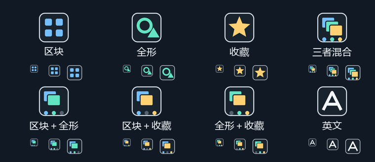

# Unicode 模式状态图标

2026-10-06：将小狼毫原来显示 A／中的状态位置接入三模式图标。

- 蓝色四格：区块；绿色圆环与三角：全形；金色星星：收藏。
- 两层和三层混合使用彩色叠层，下方蓝／绿／金固定位置的小点表示开启的来源。
- 英文使用 A；三种来源全关显示灰色禁止符号。
- 九种 ICO 尺寸：16、20、24、32、40、48、64、128、256；图形由 `工具/mode_icons.py` 中的几何绘制生成。
- 各显示方案的 `show_notifications: false` 关闭切换临时提示框。

## 接入依据

本机小狼毫为 0.17.4。官方 [RimeWithWeasel.cpp](https://github.com/rime/weasel/blob/0.17.4/RimeWithWeasel/RimeWithWeasel.cpp) 的 `_LoadSchemaSpecificSettings` 读取 `schema/icon` 和 `schema/ascii_icon`，`_GetStatus` 在方案 ID 改变时更新样式。[WeaselTrayIcon.cpp](https://github.com/rime/weasel/blob/0.17.4/WeaselServer/WeaselTrayIcon.cpp) 根据 Unicode／英文状态载入对应文件。因此采用共享词典和 Lua 的八个显示方案，图标刷新时保留输入和光标，不修改三套字符编码。

常规入口 `personal_unicode_modes` 保留原名「Unicode 三模式」，其他显示方案为 `personal_unicode_modes_0`、`_2`～`_7`。发布器自动注册以恢复上次选择。选择具体组合的显示方案时也会启用对应组合。

## 验证

使用本机真实 Rime 核心在隔离目录以及本机已部署编译文件的副本中检查：七种非空组合、中文和扩展开关、252 次候选查询、495 个圆形候选完整翻页、独立左／右 Shift、组合和长按、切换过程中输入与光标不丢失、不意外上屏、英文状态保留、无显式选方案的冷启动恢复。

检查八个编译显示方案中的图标路径及通知配置，并用 Windows `LoadImageW` 验证图标在 16／20／24／32／48 像素下可加载，ICO 文件包含全部九档尺寸。

窗口检查只能捕获记事本窗口，未取得任务栏图标区域的截图；任务栏实际显示位置未作目视验收。发布备份与全部源文件校验值保存在 `原型/rime/备份/unicode-modes-日期时间/manifest.json`。
