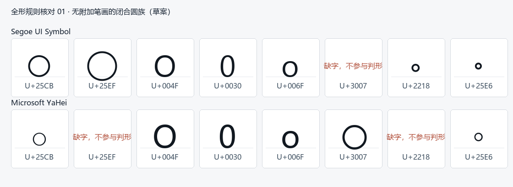
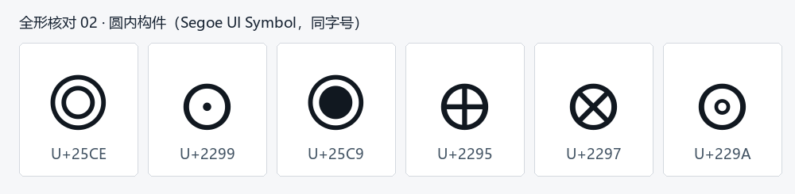
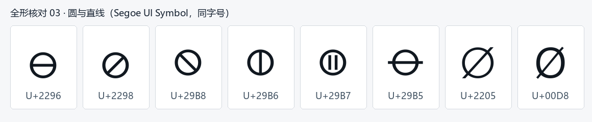
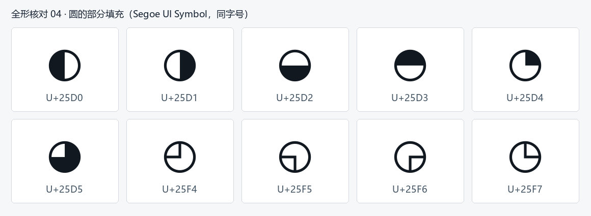
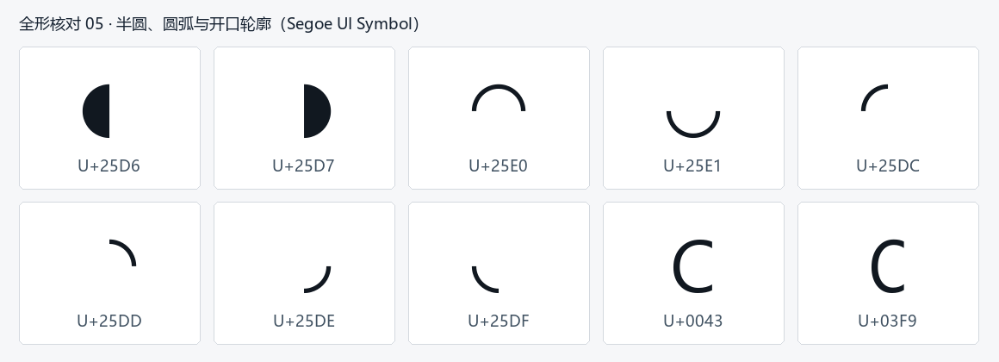
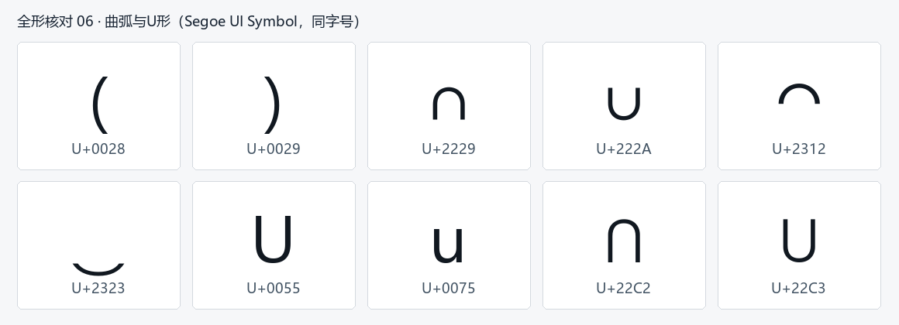
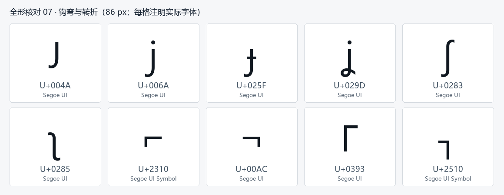

# 全形规则逐项核对

## 2026-10-08 工程接入状态

已将第01、02、03、05、06批42个字符、62条已确认路径接入独立全形码本的 `paths` 列表；第04、07批仍未启用。两码查形族，三码查已启用路径的前缀，四码精确查询，同字多路径在一次查询中去重。保留每条取形依据、参考字体与规则版本；区块和收藏码未改变。网页可逐条开关已确认路径，未启用试验不会进入词典。

三模式词典及Lua源已生成，网页与导出检查通过；当前在Mac测试，Windows隔离Rime及真实文本框试打尚待。此前关于“后两位为空”“正式四码未启用”的文字是以下按日期保留的历史现场，不再代表本次软件查询状态。

状态：四位框架和前三批已核对；第四批字形仍在试验。2026-10-07 已授权覆盖第四位统一布局。

## 每批必须比对已有键义
## 每次出稿逐码详注（2026-10-08 用户要求）

用户不需要记住每个位的字母含义。以后每次给出候选码，必须同时标注四个位的字母和含义：第一位主形、第二位状态、第三位取形特点、第四位补充信息。第四位描述钩尾位置、角点位置、开口朝向或整体尺寸，也必须单独说明。

同一字母跨位不能省略解释，例如jgvv中第三位v为纵长、第四位v为大尺寸；jgjn中第一位j为钩弯主体、第三位j为钩尾。多码字符每一条路径都应解码，不能只解释默认展示码。

运行 `python 工具/render_shape_batch.py --batch 数据/三模式/全形圆族试验-07.json` 生成对应详表；`--all` 重建全部批次。详表来自当前批次记录，缺少键义时阻止出稿，不自行猜测。查看[第七批全部逐码说明](批次逐码说明/第07批逐码说明.md)。

## 前两位重新审查（2026-10-08）

用户指出主形j钩弯与特点j钩尾重复，要求盘点前两位并讨论重设计。完整旧表、已核对与待核对范围及建议见[前两位键义盘点与重设计讨论](前两位键义盘点与重设计讨论.md)。本次没有修改已有字码，新增批次前先审查分层；仅换字母不能解决同功能重复。

2026-10-07 用户要求：后续批次必须同时对照第三、第四位已有规则，检查字母重叠及功能重复。

同一键位坚持一键一义；新增功能优先使用空闲字母，已经确认的键义优先保留。第三、第四位之间的字母复用单独报告，不自动视作同位冲突。相近功能（例如正置与横／竖、位置方向与倾斜方向）也单独列出人工检查，不能仅凭不同功能名就认定互不重复。

生成每一批字符码前，声明其第三、第四位 `functionIds`，运行 `python 工具/audit_shape_rules.py`；尚未记录的新批次使用 `--candidate 批次.json`。检查失败时先修正规则，再展示候选。展示时必须附上本批沿用键、新增键、冲突／功能重复结果及相近功能提示。

当前完整登记和空闲字母见 [全形后两位键义比对](全形后两位键义比对.md)。功能 ID 的定义仍须人工审核；工具不能自动证明所有自然语言含义互不重叠。

## 已确定的四位框架

2026-10-06 用户确定：全形模式不按数字、字母或 Unicode 区块区分，编码依据实际字形。四位框架如下；具体字母键义与取码优先级尚待实例核定。

| 键位 | 作用 | 可记录的特征 |
|---|---|---|
| 第一位 | 主体形状 | 圆／椭圆、方框、三角、线条、曲弧等 |
| 第二位 | 主体结构状态 | 空心、实心、开口、局部填充等 |
| 第三位 | 最显著的特殊特点 | 无、点、直线、交叉、圆环、三角、钩尾等构件；近圆、纵长、横扁等比例特点 |
| 第四位 | 补充分辨信息 | 主体之外的构件；相对相似字符的大／小；居中、左／右／上／下、包围、穿过、相交、分离等关系 |

每个检索码内，第三位选择一个明确的取形特点，第四位补充它的方向、关系或尺寸。同一个字符可以同时登记多条适用路径，不必强制选择唯一特点；每条路径的规则应可复用。同位字母仍保持一键一义。

以下是待检验的优先级建议，并非用户已确认的细则：

1. 没有独立附加构件时，第三位优先记录长宽比例，第四位记录相对尺寸。
2. 只有一个明显附加构件时，第三位优先记录构件形状，第四位记录其位置或与主体的关系。
3. 同时存在内部与外部构件时，试验第三位记录主要特殊构件、第四位记录另一个具有辨识力的构件；这会占用表达关系或大小的位置，应明确固定选择顺序，不能临时任选。
4. 仍无法稳定拆分时，允许同码或留待研究，不能按字符名称、读音、语种和来源补造形码。

大小与长宽比例在固定参考字体、同一字号下判断。相对尺寸以明确的相似形族为比较范围；不同字体产生不同字形时，记录参考依据。具体档位边界尚未确定。

此节确认的是框架，不是正式字符四码。目前第三、四位在有效码本中仍为空，未发布新的四码到小狼毫。

## 核对方式

按形族推进，逐字检查轮廓、闭合与开口、填充、内部及外部构件、方向和排列关系。记录码位、参考字体与判断依据；名称只用于识别字符，不能代替字形判断。缺字方框不参与分类。

同形或相近字形跨 Unicode 区块进入相同或相邻形族；字符身份按码位分别保留。允许一码多字，也允许一字多码。每个码都必须有适用的字形依据；同一字符同一码只登记一次，不设重码数量上限，不为填满键位拆组。

每批先核对前两位及边界，再用实际字符检验第三、四位的细分轴。同一个特征应有稳定的键义与优先级；没有确定的细分规则时，后两位继续为空，不能补占位字母。后续启用细分码前须同时更新编辑器、保存格式、查询与 Rime 导出，使两码族查询和三／四码精确查询分别生效。

用户确认后，将该批覆盖记录写入独立全形码本，保留参考字体、审核状态与规则版本，发布到小狼毫；区块码与收藏码不随全形核对改变。

## 已确认的第四位统一布局

2026-10-07 用户授权覆盖，当前布局：`数据/三模式/全形第四位-当前布局.json`。旧布局及原批次在覆盖备份中保留；原始确认记录只作为历史，不再作为当前字母分配。

| 功能组 | 当前键义 |
|---|---|
| 上下左右位置 | w上、s下、a左、d右 |
| 四角位置 | j左上、k右上、n左下、m右下 |
| 尺寸 | z微小、x小、c中、v大 |
| 单线倾向 | h横向、i纵向、l左上斜、r右上斜 |
| 构件正斜 | e正置、q斜置 |

方向采用游戏WASD；四角采用JK/NM；尺寸采用底排ZXCV，从左至右增大。原 m中等迁c，v纵向迁i，a正置迁e。第三位分类没有随本次布局改变。

尺寸描述的对象：无附加构件时看主体，有明确内构件时看构件；位置与倾向的区别仍在完整比对报告中列为人工检查。尺寸数值阈值仍为测量试验，未因为字母布局确认而成为通用标准。

本次覆盖规则、批次码和编辑器试验笔记。有效码本仍只有全形两码，后两位为空，不能据此宣称四码输入已上线。启用细分码时还需同步修改编辑器、保存校验、查询和Rime导出。

## 第 01 批：基础空心圆族

状态：字形已核对；第四位布局已确认覆盖。

主参考Segoe UI Symbol；〇使用Microsoft YaHei。固定同字号比较，缺字方框不参与判形；同形同尺度允许同码。比例s近圆/v纵长/h横扁。测量宽高比与em尺寸边界留在批次数据中，仅供试验复核。

| 字符 | 码位 | 当前批次四码 |
|---|---|---|
| ○ | U+25CB | `oesc` |
| ◯ | U+25EF | `oesv` |
| O | U+004F | `oesc` |
| 0 | U+0030 | `oevc` |
| o | U+006F | `oesx` |
| ∘ | U+2218 | `oesz` |
| ◦ | U+25E6 | `oesz` |
| 〇 | U+3007 | `oesc` |

可复核记录：`数据/三模式/全形圆族试验-01.json`，含历史确认、字体依据与改码记录。

## 第 02 批：圆内构件

状态：字形已核对；第四位布局已确认覆盖。

oi为圆内构件。第三位o内空心环/d内实心点或圆面/x交叉。内点、内环默认居中，第四位区分构件大小；交叉第四位区分正斜。⊚在参考字体里是大小不同的两个环，不能仅按名称推断为三个环。

| 字符 | 码位 | 当前批次四码 |
|---|---|---|
| ◎ | U+25CE | `oiov` |
| ⊚ | U+229A | `oiox` |
| ⊙ | U+2299 | `oidz` |
| ◉ | U+25C9 | `oidv` |
| ⊕ | U+2295 | `oixe` |
| ⊗ | U+2297 | `oixq` |

可复核记录：`数据/三模式/全形圆族试验-02.json`，含历史确认、字体依据与改码记录。

## 第 03 批：圆与直线

状态：字形已核对；第四位布局已确认覆盖。

第二位i表示内含或仅接触圆周，x表示明显穿出；忽略抗锯齿或线帽微小超出。第三位l单线、n重复排列；第四位h横/i竖/l左上斜/r右上斜。斜向按从下端看向上端判定。∅与Ø依字形同码，不按身份区别。

| 字符 | 码位 | 当前批次四码 |
|---|---|---|
| ⊖ | U+2296 | `oilh` |
| ⊘ | U+2298 | `oilr` |
| ⦸ | U+29B8 | `oill` |
| ⦶ | U+29B6 | `oili` |
| ⦷ | U+29B7 | `oini` |
| ⦵ | U+29B5 | `oxlh` |
| ∅ | U+2205 | `oxlr` |
| Ø | U+00D8 | `oxlr` |

可复核记录：`数据/三模式/全形圆族试验-03.json`，含历史确认、字体依据与改码记录。

## 第 04 批：部分填充与圆内角折

状态：字形试验待核对；第四位布局已确认覆盖。

第二位p部分填充，i内含。第三位b半填充/q四分之一黑/g四分之一白/a角折。b/q看黑区，g看白区，a看角折围出的扇区。◴至◷是空心圆内折线；◕的白区不是外轮廓开口。本批字形分配仍待核定，确认的是统一第四位键义。

| 字符 | 码位 | 当前批次四码 |
|---|---|---|
| ◐ | U+25D0 | `opba` |
| ◑ | U+25D1 | `opbd` |
| ◒ | U+25D2 | `opbs` |
| ◓ | U+25D3 | `opbw` |
| ◔ | U+25D4 | `opqk` |
| ◕ | U+25D5 | `opgj` |
| ◴ | U+25F4 | `oiaj` |
| ◵ | U+25F5 | `oian` |
| ◶ | U+25F6 | `oiam` |
| ◷ | U+25F7 | `oiak` |

可复核记录：`数据/三模式/全形圆族试验-04.json`，含历史确认、字体依据与改码记录。

## 每批比对与回归

当前登记：[全形后两位键义比对](全形后两位键义比对.md)。`python 工具/audit_shape_rules.py` 比对当前全部批次；`--candidate 批次.json` 检查下一批；`--layout 布局.json` 只预演新布局，不改原批次。

## 第 05 批：实心半圆、圆弧与开口圆

状态：2026-10-07 用户确认本批十个候选码；参考字体Segoe UI Symbol，86 px。沿用已确认的game-layout-v1。

### 后两位已有规则比对

- 第三位新增 `p` 半轮廓（portion）、`f` 四分之一轮廓（fourth）、`u` 轮廓开口／缺口（unclosed）。三键此前均未占用，未复用已用于填充的 `b/q/g`。
- 第四位没有新增键义：a左/d右/w上/s下，四角j左上/k右上/n左下/m右下，完全沿用现有布局。
- 同位字母冲突及登记功能重复均为0。第三位新键f/p/u也没有与第四位当前键义重叠。原有位置与倾向等相近功能仍保留人工提醒。
- 半轮廓与半填充、四分之一轮廓与四分之一填充是不同功能：前者改变可见轮廓，后者在完整外轮廓内改变填充。图中◖缺少另一半圆轮廓，不能按◐的部分填充取码。

### 试验主形边界

2026-10-07 用户明确将C、Ϲ归为主形c：它们作为C形圆弧识别，不按圆形减去一角识别。半圆弧、四分之一圆弧、C形长弧在本批同属c，不再用超过半周作为归入o的门槛。o在本批用于实心半圆；其他细小缺口环、括号、U形等边界仍需后续实例检验。

◖、◗是闭合实心半圆，第二位f；弧和C形轮廓开放，第二位g。上一批◕的白色扇区仍在完整闭合圆内，不属于这里的外轮廓缺口。

第三位选择轮廓特点，第四位描述该特点所在位置：半轮廓与四分之一轮廓看弧段所在部分；u看轮廓开口朝向。u不是把C解释为圆形减去一个扇区。不能临时任选保留或缺失方向。

| 字符 | 字形判断 | 试验码 |
|---|---|---|
| ◖ | 实心半圆，保留左半轮廓 | `ofpa` |
| ◗ | 实心半圆，保留右半轮廓 | `ofpd` |
| ◠ | 上半圆弧 | `cgpw` |
| ◡ | 下半圆弧 | `cgps` |
| ◜ | 左上四分之一圆弧 | `cgfj` |
| ◝ | 右上四分之一圆弧 | `cgfk` |
| ◞ | 右下四分之一圆弧 | `cgfm` |
| ◟ | 左下四分之一圆弧 | `cgfn` |
| C | C形圆弧，开口朝右 | `cgud` |
| Ϲ | C形圆弧，开口朝右 | `cgud` |

C与Ϲ按实际字形同码，不因拉丁／希腊身份区分。当前后两位优先轮廓与方向，大小和长宽比例暂不编码。本批十个候选码及p/f/u细分键义已确认；扩展到其他字体与形族时继续检验边界，有效全形细分位未启用。

## 第 06 批：曲弧与U形，多码重分配

2026-10-07 用户要求新增多码，重新分配。本批10个字符30条路径已于2026-10-07获用户确认。参考字体Segoe UI Symbol，86 px；测量值及字体文件校验值见批次JSON。

### 与后两位已有规则比对

第三位全部复用：v纵长、h横扁、p半轮廓、u开口视角。第四位复用a左/d右/w上/s下，并新增使用已登记的c中/x小尺寸。没有新增键义，同位冲突及登记的同功能异字母重复均为0。

主形c为单段曲弧；u为两侧近直臂连接弯底／弯顶，倒置不换主形。本批开口方向路径、弧身方向路径、整体尺寸路径并存；默认展示码不是唯一有效码。

### 当前多码表

| 字符 | 形状／方向路径 | 整体尺寸路径 |
|---|---|---|
| ( | `cgva`、`cgpa`、`cgud` | `cgvc` |
| ) | `cgvd`、`cgpd`、`cgua` | `cgvc` |
| ∩ | `ugus` | `ugux` |
| ∪ | `uguw` | `ugux` |
| ⌒ | `cgpw`、`cgus` | `cgpc` |
| ⌣ | `cghs`、`cgps`、`cguw` | `cghc` |
| U | `uguw` | `uguc`、`ugvc` |
| u | `uguw` | `ugux` |
| ⋂ | `ugus` | `uguc`、`ugvc` |
| ⋃ | `uguw` | `uguc`、`ugvc` |

### 取形依据与省略信息

- v/h描述比例；p描述近似半轮廓；u选择以开口作为检索重点。比例、轮廓和开放形态可以同时成立，每个码只采用其中一条明确路径。同一参考字形下v/h一般不同时取。
- 曲弧方向码看弧身凸出侧或半轮廓所在侧；开口方向码看开口朝向；尺寸码描述整体，不描述开口宽度。每条记录包含fourthTarget，避免临时切换描述对象。
- U、⋂、⋃的纵长+中尺寸路径ugvc不记录开口方向；uguc按开放U形与中等大小检索，同样不表达开口向上还是向下。∩、∪、u的ugux按开放U形与小尺寸检索，也不表达朝向。这些共同码允许重码，字符仍按码位分别保留。
- 当前字体下最长边/字号：括号约0.860；⌒0.628；⌣0.791；U0.709；⋂、⋃0.651；∩、∪0.500；u0.512。采用既有试验尺寸区间，中档(0.60,0.90]、小档(0.35,0.60]。这只是本次测量依据，不是已确认的全形通用阈值。
- ⌣的cgps是“近似扁的下半椭圆轮廓”候选，待人工核对；不宣称它严格是数学椭圆的一半。普通半圆弧不能仅因包围盒宽于高就自动归横扁。

### 多码保存与检查

每字符codes数组记录code、basis、fourthTarget、status，proposedCode仅兼容展示。所有备选码均参与键义检查、重复检查和布局迁移。同字符同一码去重，不限制同字符的合理码数，也不限制一码命中不同字符的数量。

同位一键一义仍适用，但同字符可以有多条不同特征路径。未来正式编辑器查询和Rime导出须收录所有启用路径，并在同次查询中合并同字符；当前仍是批次试验，有效码本与小狼毫正式细分查询未启用。

## 第 07 批：钩弯、回环与角折

状态：候选待核对。10个字符30条路径。每格标明实际字体，均为86 px。

### 字体预检

Segoe UI Symbol直接渲染ɟ、ʝ、ʃ、ʅ为缺字方框，因此本批字母及音标字符使用Segoe UI；⌐、┐在Segoe UI中缺字，改用Segoe UI Symbol。字体预检图与字体文件SHA256随本机资料保存，缺字方框不参与分类，未启用隐式字体回退。

### 旧键义比对

- 第三位新增j钩尾，之前该位未占用；复用d点、l单线、o空心环、n重复、v纵长、h横扁、a角折。第四位全数复用JK/NM、W/S、H/I及C/X/V，不增新键义。
- 新的第三位j与第四位j左上属于跨位复用，报告会明确提醒；同位字母冲突及登记功能重复均为0。
- d/o在早期样本中是内点/内环。本批试验把相同构件形状用于字形上方的外点、下方的底环；不把内外关系混进构件形状键义，需用户核对这个适用范围。
- 主形候选j钩弯、p回环、a角折，与此前c曲弧、u容器的结构边界一起逐步核对。本批ʝ保留p/j两条有依据的候选主形路径，不强制归唯一主形。

| 字符 | 构件／位置路径 | 整体尺寸路径 |
|---|---|---|
| J | `jgjn` | `jgvc` |
| j | `jgjn`、`jgdw` | `jgvv` |
| ɟ | `jgjn`、`jglh` | `jgvc` |
| ʝ | `pgos`、`pgdw`、`jgos`、`jgdw` | `pgvv`、`jgvv` |
| ʃ | `jgjk`、`jgjn`、`jgni` | `jgvv` |
| ʅ | `jgjj`、`jgjm`、`jgni` | `jgvc` |
| ⌐ | `agaj` | `aghx` |
| ¬ | `agak` | `aghx` |
| Γ | `agaj` | `agvc` |
| ┐ | `agak` | `agvx` |

### 取形对象与需要核对的边界

- 钩尾j的第四位描述钩的端点在主体哪一角：J下钩在左下n；ʃ上钩右上k、下钩左下n；ʅ上钩左上j、下钩右下m。不以语种、字母大小写或符号名字决定位置。
- ɟ的附加横线用l+h；j/ʝ上方点用d+w；ʝ底环用o+s。点与环的形状、它们的位置、整体尺寸分别形成独立路径，不能因为有多个构件就把未编码的信息假装包含在每条码中。
- 独立角折a的第四位看角点在整个图形的哪一角：⌐/Γ左上j，¬/┐右上k；圆内角折仍按第四批已经声明的扇区位置取码。两个参照对象不同，须由主形/分支规则明确，不能在同一分支临时改看角点或开口。
- ʃ/ʅ的jgni按两个钩形构件纵排检索，是否把反向相似构件视作重复需要核对；该码不表达各钩的左右位置。
- j的点加下伸部使整体墨迹高度大于J，当前固定字体下落入v大/J为c中；这是实际字形尺寸，不按“大写一定大、小写一定小”分组。
- ʝ有局部闭环但仍有开放长干，第二位g在本批描述整体有开放端；闭环位置由o路径表达。这项复合轮廓规则需核对。

所有路径均为本批候选，正式四码查询未启用。主形归属、钩与硬折的边界，以及新增j钩尾需人工确认。
