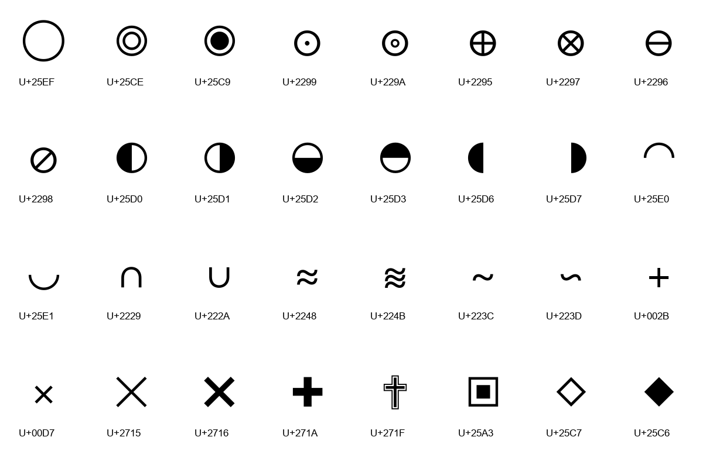
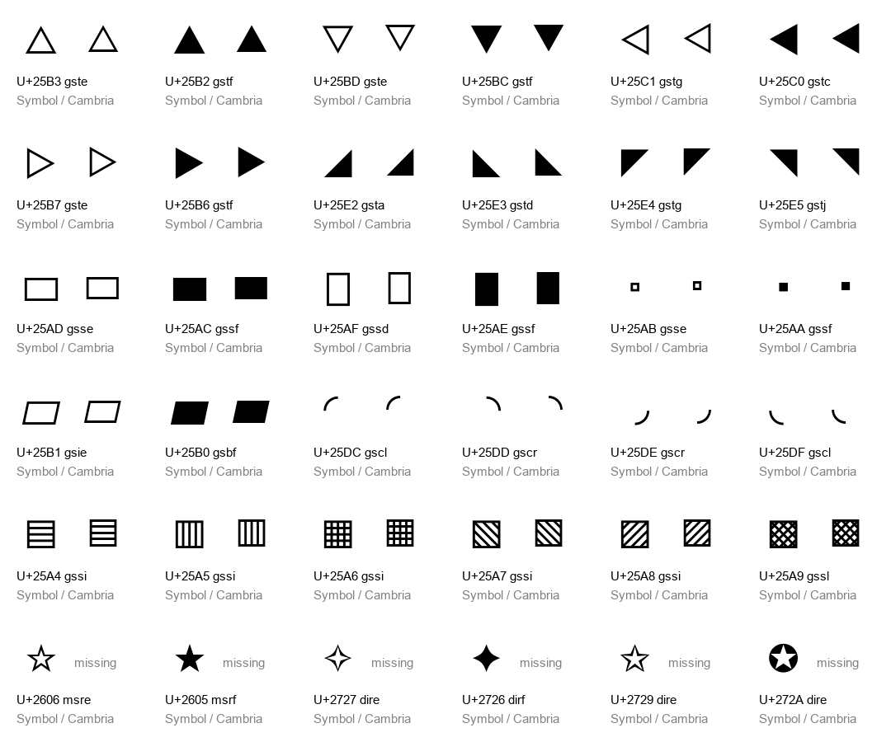

# 音形键位分配

## 四码模型

常规输入码写作 `ABCD`：

- `AB`：音感、情绪或个人联想。它属于使用者的私人记忆，不能仅凭 Unicode 名称自动推断。
- `CD`：圆、点、线、角、方向、对称等形态。机器可以提出标签和候选键，但最终映射需要通过试打稳定下来。

26 个单字母可以记录基础感觉，676 个双字母则各自拥有独立含义，不必机械继承两个单字母的拼接解释。联想图谱允许一个字符连接多个中文概念和多个输入别名；真正导出时仍以 `AB + CD` 形成四码，机器批量码默认每码最多 5 个候选；人工复核的常见相似图形允许同码最多 10 个候选。

首版 2000 字符仍可作为人工试验集；全量 Unicode 另建立机器工作码，使所有字符先能输入，再逐步把常用字符改成符合个人联想的稳定码。

## 容量与短码

- 四个小写英文字母共有 `26^4 = 456,976` 种组合，足以承载十几万 Unicode 字符和大量重复码候选。
- 当前 Rime 使用 `auto_select: true` 与 `max_code_length: 4`：第四码无重码时自动上屏，二码候选不会强制截断后续输入。因此 `𓆟 = jj` 与 `jj / jn / jw / jx` 字块四码可以共存。
- 建议只把极少数高频、已形成肌肉记忆的字符设为两码；其他字符使用四码或允许重复码候选。

一个两键前缀只有 `26^2 = 676` 个不同后缀。首版中的单个 Unicode 区块可以放进一个前缀；完整 Unicode 中的大型区块则必须拆成视觉子族，或允许重码候选。普通汉字继续交给小鹤音形；独立的 BMP 汉字方案只用于 Unicode 研究和偶尔查找，不与符号联想方案混装。

## 可以使用哪些键

Rime 的编码字母表可以配置为其他可打印字符，但本项目保持 `a–z`：

- 小写字母不与候选选择和标点直出冲突，跨键盘布局也最稳定。
- 数字键默认用于选择候选；加入编码会牺牲数字选词。
- 逗号、句号、分号、引号、斜杠等可以配置，但会与标点、翻页或反查入口冲突。
- 空格、回车、退格、Esc 和方向键承担确认、编辑、取消与导航，不作为连续码表字符。
- Shift、Ctrl、Alt 组合适合功能快捷键，不适合四码中的一个字符。

## 前两键分配优先级

1. 已明确指定的完整码最高优先，不批量改写。
2. `jj` 单独保留给 `𓆟`；埃及象形文字使用 `jj / jn / jw / jx` 四个字族前缀，`༳ = my` 继续作为独立二码。
3. 最新前缀为 `ܜ → mc**`、`¤ → qt**`，旧四码只保留在实体页历史记录中。
4. 其余字符优先继承同一 Unicode 区块的锚点前缀。
5. 同一区块已有多个旧前缀时不强行改码，而是按视觉子族选择最接近的锚点。例如 Geometric Shapes 已有 `○ = ybin`、`◌ = axth`、`● = fpys`，以后可以分别承载轮廓圆、承载/点状圆和实心圆子族。

全量分配时，未锁定区块优先使用英文区块名主要单词的首字母，例如 Kirat Rai 使用 `kr`。大型区块可继续占用多个相关或空闲前缀；一个机器生成的前缀页只服务一个 Unicode 区块，避免把大区块塞进其他小区块的剩余容量。当前 336 个主区块被组织为 380 个前缀页，详细映射见 [[数据/Unicode全码表/说明]]。

当前区块锚点包括：Odia `bo`、Armenian `as`、Geometric Shapes `yb/ax/fp`、Miscellaneous Mathematical Symbols-B `dd`、Cuneiform `mv`、Unified Canadian Aboriginal Syllabics `qd/ln`、Tamil `pi`。Egyptian Hieroglyphs 另按 `jj` 生命形、`jn` 自然、`jw` 器物、`jx` 抽象分组。这些是项目入口，不是 Unicode 官方分类。

楔形文字区块因有 922 个字符，项目内部再按连续码位拆为 `mv`（U+12000–U+120FF）、`mu`（U+12100–U+121FF）、`mn`（U+12200–U+122FF）与 `mw`（U+12300–U+12399）。这只是便于输入、翻页和独立微调规则的内部子页，不是 Unicode 官方子区块；`𒁔 = mvma` 保持不变。

## 后两键形态码 v0.1

推荐把第三键固定为“主骨架”，第四键固定为“最显著修饰”。只记最先看见的两个特征，不试图编码全部细节。

### 第三键：主骨架

| 键 | 主骨架 | 键 | 主骨架 |
| --- | --- | --- | --- |
| `o` | 圆、环 | `d` | 点、短点阵 |
| `l` | 直线、横竖线 | `c` | 曲线、弧 |
| `a` | 角、折线 | `t` | 三角、楔形 |
| `s` | 方、框 | `x` | 交叉、十字 |
| `v` | 开口、V 形 | `r` | 放射、星芒 |
| `w` | 波浪、连续起伏 | `p` | 螺旋、回环 |
| `b` | 块、面 | `m` | 多部件、复合形 |
| `h` | 人形、枝杈 | `q` | 奇形或暂难归类 |

### 第四键：修饰状态

| 键 | 修饰 | 键 | 修饰 |
| --- | --- | --- | --- |
| `e` | 空心 | `f` | 实心、填充 |
| `i` | 内含、套叠 | `g` | 有缺口、开放 |
| `p` | 成对 | `m` | 多个、重复 |
| `s` | 对称 | `a` | 不对称、偏置 |
| `u` | 向上 | `d` | 向下 |
| `l` | 向左 | `r` | 向右 |
| `h` | 横向 | `v` | 纵向 |
| `x` | 穿过、重叠 | `k` | 钩、尾巴 |

### 大型字块的 26 键扩展

上述 16 键是手工记忆的核心词表。为了让大型 Unicode 字块满足“每个四码最多 5 个候选”，机器分组可以使用其余字母，但不改变原有键义：

| 第三键 | 扩展主骨架 | 第三键 | 扩展主骨架 |
| --- | --- | --- | --- |
| `e` | 椭圆、长圆 | `f` | 人物轮廓 |
| `g` | 动物、有机体 | `i` | 细柱、细竖形 |
| `j` | 钩弯 | `k` | 绳结、纠结形 |
| `n` | 成列、成排 | `u` | 容器、U 形 |
| `y` | 分叉、翼形 | `z` | 阶梯、锯齿 |

| 第四键 | 扩展状态 | 第四键 | 扩展状态 |
| --- | --- | --- | --- |
| `b` | 下部较重 | `c` | 封闭、闭合 |
| `j` | 悬挂、垂钩 | `n` | 狭长 |
| `o` | 外包、围合 | `q` | 倾斜 |
| `t` | 上部较重 | `w` | 宽展 |
| `y` | 分叉 | `z` | 分层、错落 |

扩展键首先服务于大字块的视觉聚类；人工给单字编码时仍可优先使用上面的 16 键核心词表。这样既保留联想的一致性，也把单码候选数控制在可见的一页内。

例如 `○ = yboe` 使用圆＋空心，`● = fpof` 使用圆＋实心，`⦿ = ddoi` 使用圆＋内含。旧四码保存在实体页中，但不再作为当前输出码。

如果两个字符得到同一码，不必立刻创造生僻规则：允许它们作为同码候选，反而能保留“惊喜感”。只有某个字符使用频率明显升高时，再给它独立后缀。

### 候选上限

用户于 2026-10-05 确认：常见图形本身形状相似，允许每个四码最多 10 个候选（含 10）；不为满足五候选而扭曲形码或强行拆开同形族。这个例外适用于人工复核的常见图形族，不自动扩展到全部 Unicode 字块。

机器批量字块继续采用默认约束：每个四码最多5个候选。先按前缀分大族，再按归一化字体轮廓分主形族；同一“前缀＋主形”内部继续聚成最多5个字符的小组，最后用状态键区分。容量平衡不能覆盖人工锚点，`𓆟` 固定为二码 `jj` 和形态四码 `jjgh`。

## 形态码实验方法

先用 `shape_hints` 记录可观察特征：

`圆`、`点`、`线`、`角`、`方向`、`对称`、`方`、`星芒`、`曲线`。

试用时记录：第一眼想到的形态、实际按出的后两键、是否与相邻字符混淆。v0.1 允许调整；积累一批真实输入后，再把高一致性的联想固化。这样后两键来自你的视觉习惯，而不是 Unicode 英文名称的偶然措辞。

## 图形严格判定草案 v0.2（2026-10-05）

本节用于人工复核，不把机器工作码视为已确认形码。第三键记主骨架，第四键记区分同族字符的结构；区块前缀、真实读音、名称含义和图形特征分别记录。

### 可复核的判定条件

- `c` 曲线：主要骨架由弧线构成，未形成占主导的完整圆环。完整圆环优先 `o`；不能为了三个相邻码统一而把所有圆都改成 `c`。
- `g` 开放：主骨架存在明确端点或缺口。`c` 闭合状态：主轮廓确实首尾连接；不能根据“半月”“满月”等名称判断。
- `i` 内含：主轮廓内有独立、可辨认的部件；两个弧相接形成的透镜形空白不自动算“内含”。
- `y` 分叉：骨架有清楚的分支，能辨认至少三个分支方向；两条曲线相交优先 `x`，并列弧线不算分叉。
- `p` 成对、`m` 重复：实际可分离地看到两个或多个同类部件。线条粗细、抗锯齿造成的粘连不计部件。
- 修饰选择顺序：先看内含、交叉、分叉等能区分同族的结构，再看闭合／缺口，再看部件数量，最后看方向、对称和重心。具体字族可调整顺序，但须写明例外及例字。
- 每次确认记录码位、参考字体与版本、主骨架描述、修饰描述、排除的候选和复核状态。至少比较参考字形与日用字体；两者存在结构差异时保留为候选，不强制确认。
- 重码不改变形态定义；人工复核的常见相似图形允许不超过十个候选，超过十个再拆视觉子族；机器批量码默认仍为五个。容量调度或随机补位得到的码保持机器工作码身份。

### 巽他补充区块的三个候选

| 字符 | 用户提出的码 | 按严格规则成立的条件 | 复核意见 |
| --- | --- | --- | --- |
| ᳀ U+1CC0 | `sncy` | 曲线占主导，而且存在真实分叉 | 若只是弧线交叉，应比较 `sncx`；太阳含义不能代替形态证据 |
| ᳁ U+1CC1 | `sncc` | 曲线为骨架，主轮廓确实闭合 | 若主弧有开放端点，比较 `sncg`；半月含义本身不足以决定闭合 |
| ᳂ U+1CC2 | `snci` | 曲线骨架内含独立部件 | 若外圈是完整圆环，先比较 `snoi`；若没有内含部件，不能用 `i` |

上表是第一轮提出候选时的讨论记录；用户后续选择并同意实施的是 `᳀ = sncx`、`᳁ = sncg`、`᳂ = snoi`，已经写入复核码表，原候选 `sncy/sncc/snci` 未启用。官方字符图表把它们列为标点，分别解释为太阳、半月、满月；这些名称不是字符的实际发音，也不是形码确认依据。来源：[Unicode 巽他补充字符图表](https://www.unicode.org/charts/PDF/U1CC0.pdf)。项目数据仍按 Unicode 17 构建，在线图表会随版本变化。

### 工具验证结果与读音边界

2026-10-05 检查发现，旧生成器用子串匹配名称，把 `SUNDANESE` 中的 `SUN` 判为放射星芒；现已改为完整词匹配。修正后的自动码仍是机器工作码，不能据此宣称图形已严格分类。编辑器修改形码时现保留手工设置的前两位；显式拖动换页仍按目标页更换前缀。

真实读音复用 [[30_项目/音素机/音素机|音素机]]。已有 `原型/英语发声打字机/server.py` 的 `POST /api/analyze` 返回 IPA，但当前固定 `en-us`，不能据此生成巽他等语言的真实读音。该接口不调用音频合成；编辑器未来只保存文本记录，不保存音频。

读音记录至少包含：语言／方言、被转写的原文、IPA、来源、生成器及版本、人工复核状态。标点和没有独立读音的符号允许“无独立读音”；名称朗读必须标成名称读音。英文名称经英语引擎生成的 IPA 不能标成符号所属语言的读音。

当前编辑器没有独立 IPA 字段，也没有多字符符号组合创建入口，因此这两项属于功能缺口。现有双字母“感觉组合”可保存标签和描述，但不是多字符符号组合；字符键位保存在浏览器补丁，联想图谱通过本机服务保存到项目，两者不能混称。验证覆盖本地代码与数据，未验证线上部署和跨设备同步。

## 推荐与“惊喜感”

同一个前两键可以保留多个不同形态的候选；同一个后两键也可以跨音感前缀复用。Rime 中重复码显示候选，正好可以形成“随便打几键便出现一组好看字符”的探索模式。随机感应来自候选排序与轮换，不需要牺牲字符的稳定主码。

## 当前约束

- 最新确认的前缀、形态规则与 [[𓆟Egyptian Hieroglyph字块-编码说明|𓆟字块编码说明]] 是当前实验基线；旧四码只作历史记录。
- 第一版仍可从 [[70_unicode/个人Unicode音型输入法/数据/Unicode精选/输出/unicode-17-v1-2000预览|Unicode 17 首版 2000 字符预览]] 开始人工试用。
- 日常“个人 Unicode 符号联想”只装非汉字符号；BMP 汉字另有独立方案，补充平面汉字只保留在 `full` 研究构建中。
- 机器生成的 500 条中文联想均为 `suggested`，不绑定双字母、不启用 Rime；只有人工试打并确认后的关系和编码才视为长期规则。

### 2026-10-05 图形抽查：32 字符、28 项优化候选

本轮按易混淆的圆环、半圆、波浪、交叉和方框族定向抽样，不代表全库错误率。32 个字符由 Windows `C:/Windows/Fonts/seguisym.ttf`（Segoe UI Symbol）以 72 px 放大后逐项查看，码位与名称另对照 Unicode 官方图表；这是单字体复核，尚未完成跨字体试打。

用户本轮认可 `᳀ → sncx`、`᳁ → sncg`、`᳂ → snoi` 比上一轮候选合理。用户随后同意实施本表修改；三个巽他字符与下面 28 项均已写入 `工具/reviewed_shapes.py`，重建后状态为 `reviewed`，前缀保持原值。全量码表、编辑器初始数据和本地 Rime 符号／研究词典已同步；未部署线上版本。

| 字符／码位 | 当前机器码 | 建议码 | 图形依据 | 假设同时采用全部建议后的同码数 |
| --- | --- | --- | --- | --- |
| ◯ U+25EF | `gsod` | `gsoe` | 完整空心圆；不应标向下 | 6，符合常见相似图形十候选规则 |
| ◎ U+25CE | `gshl` | `gsoi` | 外圆内有独立圆环 | 4 |
| ◉ U+25C9 | `gsgp` | `gsoi` | 外圆内有独立实心圆 | 4 |
| ⊙ U+2299 | `mtdb` | `mtoi` | 圆环内含点；主骨架不是点 | 3 |
| ⊚ U+229A | `mtog` | `mtoi` | 圆环内含小环；外环没有缺口 | 3 |
| ⊕ U+2295 | `mtuk` | `mtox` | 圆环内有交叉横竖线 | 2 |
| ⊗ U+2297 | `mtet` | `mtox` | 圆环内有交叉斜线 | 2 |
| ◐ U+25D0 | `gsof` | `gsol` | 以黑色填充区域的位置为左 | 2 |
| ◑ U+25D1 | `gsof` | `gsor` | 以黑色填充区域的位置为右 | 1 |
| ◒ U+25D2 | `gsof` | `gsod` | 以黑色填充区域的位置为下 | 1 |
| ◓ U+25D3 | `gsof` | `gsou` | 以黑色填充区域的位置为上 | 1 |
| ◠ U+25E0 | `gsop` | `gscu` | 开放上拱弧；并非完整圆 | 1 |
| ◡ U+25E1 | `gsos` | `gscd` | 开放下拱弧；并非完整圆 | 1 |
| ∩ U+2229 | `mtay` | `mtcu` | 上拱曲线；没有分叉 | 1 |
| ∪ U+222A | `mtdb` | `mtcd` | 下拱曲线；并非点状 | 1 |
| ≈ U+2248 | `mtnf` | `mtwp` | 成对波浪；并非实心 | 1 |
| ≋ U+224B | `mtem` | `mtwm` | 三条重复波浪；并非椭圆 | 1 |
| ∼ U+223C | `mtbf` | `mtwh` | 单条横向波浪 | 2 |
| ∽ U+223D | `mtei` | `mtwh` | 单条横向反向波浪；没有内含 | 2 |
| + U+002B | `blos` | `blxs` | 直线十字＋对称；没有圆环 | 1 |
| × U+00D7 | `lssc` | `lsxs` | 斜线交叉＋对称；没有方框 | 1 |
| ✕ U+2715 | `digl` | `dixs` | 斜线交叉＋对称；不是动物 | 2 |
| ✖ U+2716 | `dijo` | `dixf` | 加粗实心交叉；没有外包结构 | 2 |
| ✚ U+271A | `dixh` | `dixf` | 实心十字；横向不是主要区别 | 2 |
| ✟ U+271F | `dixd` | `dixe` | 轮廓十字，优先空心；不应标向下 | 4 |
| ▣ U+25A3 | `gsse` | `gssi` | 外方框内含独立实心小方块 | 6，符合常见相似图形十候选规则 |
| ◇ U+25C7 | `gswe` | `gsse` | 旋转方框＋空心；不是波浪 | 5 |
| ◆ U+25C6 | `gstu` | `gssf` | 旋转方形＋实心；不是向上三角 | 6，符合常见相似图形十候选规则 |

按用户本轮确认的常见相似图形十候选规则，本表 28 项建议均没有容量障碍。`◯ → gsoe`、`▣ → gssi`、`◆ → gssf` 各会形成六候选，可以保留图形上更一致的码，无需仅为候选数拆族。用户随后同意本表修改，现已实施；图形族十候选例外与编辑器提示、联想码启用检查、码表及导出校验保持一致，其他机器码维持五候选。计数包含库内已有同码字符；浏览器个人补丁可能使计数不同。

本轮四个暂未建议新码的样本是 `⊖ ⊘ ◖ ◗`：前两个需要先统一“内线触及外圈”时内含与交叠的边界，后两个需要先统一实心半圆在圆环族与曲弧族中的归属。暂不靠随机第四键掩盖这些规则问题。

新增可操作约定：方向键在半填充圆族中指黑色填充的位置；在开放弧族中指弧的拱起方向，因此 `◠/∩` 为 `cu`、`◡/∪` 为 `cd`，不是开口方向。完整圆内含小圆不区分内部空心／实心时可同码；`◎/◉`、`⊙/⊚` 均允许作候选。旋转方形仍归 `s` 主骨架，第四键优先保留空心／实心；大小、粗细、旋转不能强行挤占更能记住的结构特征。

可继续优化生成器的方向：先识别明确的 `CIRCLED`、`DIAMOND`、`TILDE`、`PLUS`、`TIMES` 等图形词族，并结合部件、填充和方向的规则优先级；这些规则需经过字族复核再启用，不能把图形词覆盖个人锚点。当前未启用新批量规则。

参考：[Unicode Geometric Shapes](https://www.unicode.org/charts/PDF/U25A0.pdf)、[Unicode Mathematical Operators](https://www.unicode.org/charts/PDF/U2200.pdf)。在线图表当前显示 Unicode 18，项目码位和码表仍以本地 Unicode 17 为准。

### 2026-10-05 第二批：36 字符、11 项新候选

本批抽查三角、矩形、平行四边形、四分之一圆弧、填充方框和星形。使用 Segoe UI Symbol 与 Cambria 48 px 对照；其中前 30 个字符两字体均有字形，最后六个星形在 Cambria 缺字，不能声称已经完成双字体复核。与 Unicode 图形名称对应的码位使用本地 Unicode 17 数据。

以下仅是新的建议，尚未写入已确认码表；表中计数假设十一项同时应用。

| 字符／码位 | 当前码 | 建议码 | 判定依据 | 建议后的同码数 |
| --- | --- | --- | --- | --- |
| ◁ U+25C1 | `gstg` | `gste` | 闭合空心三角；不应标缺口 | 6 |
| ◀ U+25C0 | `gstc` | `gstf` | 实心三角；与其他实心三角同族 | 10 |
| ◢ U+25E2 | `gsta` | `gstf` | 实心直角三角；填充优先于方向 | 10 |
| ◣ U+25E3 | `gstd` | `gstf` | 实心直角三角；填充优先于方向 | 10 |
| ◤ U+25E4 | `gstg` | `gstf` | 实心直角三角；不应标缺口 | 10 |
| ◥ U+25E5 | `gstj` | `gstf` | 实心直角三角；没有垂钩 | 10 |
| ▯ U+25AF | `gssd` | `gsse` | 竖长空心方框；不应标向下 | 7 |
| ▱ U+25B1 | `gsie` | `gsse` | 倾斜空心四边框；不是细柱 | 7 |
| ▰ U+25B0 | `gsbf` | `gssf` | 倾斜实心四边形；与方框族填充规则统一 | 7 |
| ▩ U+25A9 | `gssl` | `gssi` | 方框内有交叉纹样；不应标向左 | 7 |
| ✪ U+272A | `dire` | `dioi` | 外圆包围星形；主骨架是圆，修饰为内含 | 1 |

`gstf` 在本批建议全部采用后恰为 10 个候选，仍符合用户规则；该码组若确认，需要加入十候选白名单。不要只把 `◀` 标闭合、把 `◤` 标开放来人为压回五候选。大小、朝向和尖角差异可以保留在同码候选中；若日后试打需要方向码，再作为额外别名设计。

三角族建议维持第三键 `t`、第四键 `e/f` 的空心／实心区别。平行四边形归 `s` 方框族属于规则扩展候选，尚需用户认可；不能把这项归族判断当作已经确认的定义。对于 `▩`，建议明确 `i` 可以表示可辨认的内部纹样，即使纹样与外框连接；无独立内部纹样的曲线交叠空白仍不算内含。

本批建议保持原码的 25 字符：`△ ▲ ▽ ▼ ▷ ▶ ▭ ▬ ▮ ▫ ▪ ◜ ◝ ◞ ◟ ▤ ▥ ▦ ▧ ▨ ☆ ★ ✧ ✦ ✩`。其中 `◜/◟` 与 `◝/◞` 分别同码符合弧线左右分族，不为强行区分上下角而增加任意键义。

本次实施验证：全量码表、已确认码及锚点、图谱、编辑器数据和静态服务、十候选边界、Rime 分层词典和本地同步测试通过。Rime 两份既有生成词典逐条更新了这 31 个字符；完整来源驱动重建仍受既有冷归档 `storageId/relativePath` 引用无法按普通本地路径解析的限制，不宣称本次完成了干净环境的全链路重建。未修改冷归档来源，也未部署线上服务或本机小狼毫。

### 2026-10-05 小狼毫同步部署

按用户要求，已备份并同步到注册表配置的 `C:/Users/86137/AppData/Roaming/Rime`，通过本机 WeaselDeployer `/deploy` 重新部署，退出码为 0。同步包括 31 个确认图形码，并对齐此前生成器完整词匹配修复后残留的 4,138 个旧机器码；项目符号／研究词典现与全量码表一致，二码锚点保持不变。第二批十一项建议仍未启用。

用本机 `rime.dll` 查询部署后二进制的隔离副本，31 个确认字符全部能以新码找到；`gsoe/gssi/gssf` 均有六候选。现有每页五候选配置保持不变，超过五个的同码组通过翻页选择。五个同步源文件与目标文件的 SHA-256 一致，小狼毫服务仍在运行。备份为 `原型/rime/备份/rime-sync-20261005-204729/`；可复用核对工具为 `工具/verify_weasel_codes.py`。
